# Lab6

*Due Wednesday 4/1 at 9pm.*

## Introduction

There are many reasons that Git and GitHub are essential infrastructures for collaborative coding projects. For one Git saves snapshots of a code repository at different stages of a project so that we can track how it has changed over time and revert back to an older version if we discover a more recent error. We call this version control. Certain Git features also facilitate many people working on a coding project at once, by providing a number of tools to help prevent collaborators from over-writing each other’s work. These features also make it possible for developers to simultaneously modify, extend, and test components of the code without jeopardizing the project’s current functionality. I use GitHub for assignment submission in this course because it offers a number of features for commenting on and making suggestions in your code, which will be super helpful when reviewing your group projects. Further, GitHub supports code publication; by publishing code on GitHub, you contribute to an open access/free software community, enabling others to learn from and build off of your work.

Despite all of these awesome benefits, there can be a significant learning curve when getting started with Git and GitHub. There are new vocabularies, workflows, and error mitigation strategies to learn when getting started. This lab is designed to help you get acquainted with the concepts behind Git and GitHub, suggested workflows for collaborating on projects in this course, and error resolution strategies.

## Review of Key Terms

**Repo**
Collaborative storage space for folders, documents, data, and code

**Branch**
An isolated version of a repo that can be modified without affecting the main branch

**Clone**
Creates a copy of a repo stored in a remote space (e.g. GitHub) to your local machine (e.g. your computer)

**Pull**
Downloads the latest version of a repo from remote space (e.g. GitHub) to your local machine (e.g. your computer)

**Stage**
The process of marking which changes of the code are ready to be saved

**Commit**
A stored snapshot of a repo at a particular moment in time

**Push**
Uploads commits from your local machine (e.g. your computer) to a remote space (e.g. GitHub)

**Pull Request**
A request for modified code to be integrated with a different branch

**Merge**
The process of integrating code modifications from one branch into another branch

## GitHub Flow

### `git` vs. GitHub.com

At the beginning of this semester, many of you installed `git` on your computers. `git` is a series of commands available in our computers to save snapshots of files at different moments in time. On the other hand, GitHub.com is a website where we can store projects that have been configured with `git` commands. As you’ve been accepting lab assignments for this course, project folders (what we will call repositories) have been created for you at GitHub.com. If you navigate to GitHub.com right now, you will see a list of these project folders, and you can click through each of the them to see changes that have been made. However, when you created projects for each of these repositories in RStudio, you were using `git` commands on your computer to copy the project from GitHub.com to your computer. Similarly, you were using `git` commands when you staged, committed, and pushed your changes back to GitHub.com. **In sum, `git` is a series of command line tools to manage changes to files. GitHub.com is a Web hosting platform for storing `git` projects.**

### Remote vs. Local

We can store, edit, and publish files on GitHub.com without ever copying them to our local computers. Files at GitHub.com are technically stored on a server somewhere, so we will refer to the projects stored at GitHub.com as **remote** (i.e. distant, far-off, etc). Similarly, we can use `git` commands to save snapshots of different versions of files on our local computers without ever pushing the changes to GitHub.com, so we will refer to the projects stored on on our computers as local. In this course, we need the ability to move changes to files between our local and remote repositories.

Why can’t we just do everything at GitHub.com or everything on our local machines?? Well GitHub.com doesn’t have the nice environment for writing and running code that you have in RStudio, so we need to be able to move things to your local computers so that you can work on the code in RStudio. On the other hand, if all the work was done on your local computer and never pushed to GitHub.com, I (your instructor) would never see it! So the first important consideration in the GitHub Flow is how do we move changes made on our local machines to GitHub.com and vice versa.

The great news is that you’ve already been doing this! The primary way that we move changes between remote and local is through two `git` commands: pull and push. Pull copies changes from a remote repository to our local machines. Push pushes changes from our local machines to a remote repository. It looks like this:

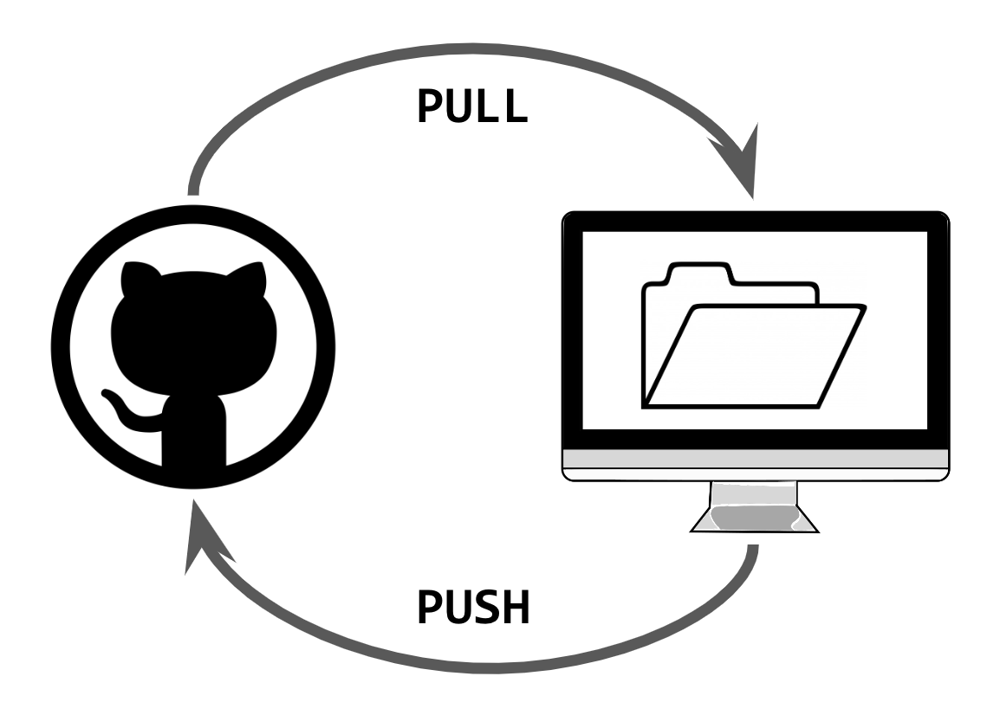

Typically, we want to make sure that we always follow this flow:

1. Pull changes from GitHub.com (remote) to local,
2. Make changes locally and save them,
3. Commit your local changes,
4. Pull changes from GitHub.com (remote) to local again to make sure that you have everything up to date, especially when you have a partner who also works on this project,
5. Push changes to GitHub.com.
   
As we are going to see later in the lab, the most frustrating issues with GitHub emerge when we break this flow.

### To Branch or Not to Branch?

In my opinion, there are two kinds of workflows for GitHub. There’s the quick and dirty version, and there’s the long and elegant version. We just went over the quick and dirty version (see above), and you’ve already had practice in it when submitting all of your labs for the course. In the quick and dirty version, all of this occurs in the main branch. 

Typically I recommend the long and elegant version for group work as it is designed to avoid errors and ensure that collaborators are all on the same page regarding changes to files. However, occasionally when you have to make small, quick changes to a file, and it won’t impact your teammate’s work, it will make more sense to follow the quick and dirty workflow. The goal for today is to get practice in the long and elegant version.

## Getting Started

You and your MP2 partner will follow the instructions below to create branches and collaborate via GitHub. 

### Clone

Cloning is a `git` command that copies a remote repository to your local machine. In other words, it will copy all of the project files in the remote GitHub.com folder to your local computer.

In RStudio, File > New Project > Version Control > Git and then copy and paste the "Clone" URL from your group's repo. 

### Branch

When you first create a repository, all of the code will be stored in the main branch of the repository. If you were to think of a project like a tree growing up from the ground, then the main branch would be like the trunk of the tree. We don’t want the main branch to break because the whole tree could come down. One goal of a branching workflow in GitHub is to keep the most stable and polished versions of code in the main branch.

So what do we do in the meantime - when we’re editing code, potentially breaking things, trying to sort out its bugs, and it’s not quite in that stable and polished state yet? That’s where branching comes in.

When we create a branch of our repo, GitHub creates a separate copy of the repo where you can make changes without impacting what’s in the main branch. Later, once we’re done making changes and things are stable and polished, we will have the opportunity to merge those changes back into the main branch.

Think of it another way: You write a rockstar first draft of a final paper, and you decide to send it to a few friends to review. You could just share the original document with them and tell them “Have at it! Edit away!” The problem is that, if they are making changes directly to the original document, you could lose some of that awesome original text. A better option would be to create separate copies for each teammate to edit, send them those copies, and then figure out how to layer in their edits later. This is like branching. The original document would be the main branch, and each copy sent to a friend would be a branch off of main. Friends can make as many edits as they want in their branch because you still have the original stable and polished copy. Later, we can merge their changes back into the main branch.

Click on the Code tab on your repo’s page at GitHub.com. Directly below this tab, you will see a dropdown that is currently labeled “main”. This means that you are in the main branch. Each member of your team should click the down arrow, and create a branch by entering their name into the textbox that appears, and then clicking “Create branch”. **(Please do not delete the feedback branch!)**

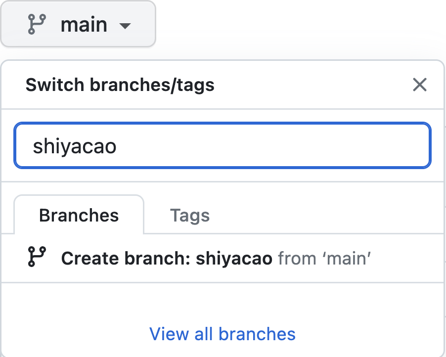

### Pull

As of right now, the branches that were created in the previous step only exist on GitHub.com, they don’t exist yet on your local machine. To get these changes to your local machine, you need to pull the changes. When we pull changes to our local machines, we are basically saying, check that remote version for changes, and then pull them into the repo on my computer.

Head back to RStudio -- your Lab6 project. In the Environment pane, you will notice a tab labeled “Git”. This is your RStudio command center for Git and GitHub. When you click on this tab, you will see a few buttons in the navigation bar. To pull changes, you should click the blue downward arrow. Click this button to pull the branches created remotely to your local machine.

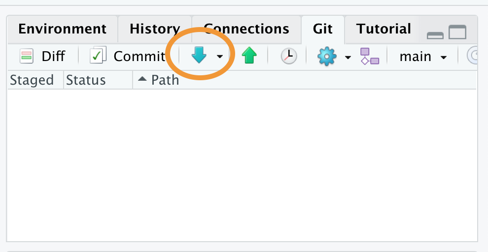

### Switch Branches

Even though you pulled the new branches to your local machine, you are still currently working in the main branch. Remember that we always want to keep the main branch stable and polished. This is not where we are going to make edits. Instead, you will make edits in the branch that you just created. Later, we will merge those changes back into the main branch.

In the top right hand corner of the Git tab, you will see a dropdown currently set to “main”. Click the downward arrow, and switch to your branch by selecting the appropriate branch.

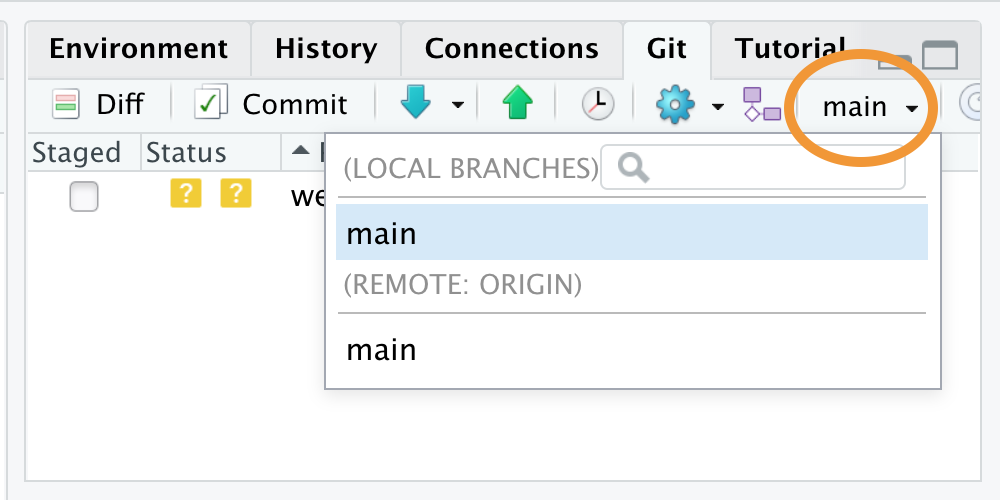

### Make Changes

Once you are in your branch, following the instructions in the Lab6.qmd file, group leader needs to copy and paste the solution code in Lec15 Post-class Exercise in Ex 1 and Ex 2; group partner needs to copy and paste the solution code in Lec15 Post-class Exercise in Ex 3 and Ex 4.

### Stage

Sometimes we make changes to a few files and save them. To let Git know which changes we want to include, we need to stage the files. Staging basically says, “these files are ready to be included.”

Once you finish making local changes, save your changes. Once you save the file you’ll notice in the RStudio Git pane that the file name appears after a blue square labeled “M” (which stands for Modified). This means that the file is ready for staging. Stage the file - indicating that it’s ready for committing - by clicking the checkbox in front of the file name.

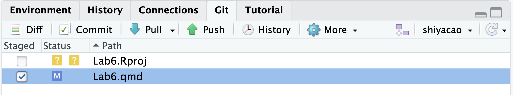

### Commit

In collaborative projects, it is typically recommended to commit often - after any major changes are made to a file. This ensures that we can eventually go back to look at very specific changes. It’s also important to label commits with descriptive titles so that we can recall what changes within that commit. Descriptive titles should detail what changes were made in the last round of edits.

To get a sense of what it means to be able to look back on these changes, check out a series of commits that I made to the GitHub repo for my research lab. While I’m not going to claim to be the most diligent commit-er, you do get a basic sense of what changes were made to the repo following each commit from these commit messages. I could click through any of these links to see what my repo looked like at this moment in time.

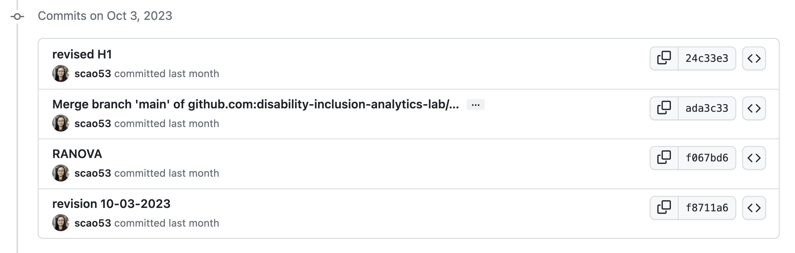

Commit your changes by clicking the ‘Commit’ button in the Git pane. When you click this button, a new window will open showcasing the changes that have been made to the staged file. You should enter a commit message in the window that appears. Remember that commit messages should be descriptive. In this case, something like “added Ex 1 and Ex 2 of Lab6” would work. Click commit. 

### Push

When you are in your own branch, you can commit, pull, and push all you want with no fear of merge conflicts even if everyone is working on the same file! Once both group members have pushed their changes, head back over to GitHub. On the main code page, switch between branches and check out the contents of Lab6.qmd in each branch. What differences do you notice?

### Pull Request

Note that now we have a few versions of our repo in separate branches on GitHub.com, and in each of those versions of the repo, the Lab6.qmd file looks a little bit different. Now that we’ve made our changes and things are stable and polished, we want to move all of those changes into the main branch. To do this, we are going to issue a **Pull Request**. This is a request that signals to all of our collaborators that we are ready to move our changes back into the main branch.

On your repo’s page in GitHub.com, click the “Pull Requests” tab, and then click the green “New Pull Request” button. You’re requesting to pull the changes from your personal branch into the main branch. This means that the *base* branch should be main, and the *compare* branch should be your personal branch. You’ll see a screen where you can compare your branch to the main branch. Click the button to “Create Pull Request,” enter a descriptive title of the changes made, and then click “Create Pull Request” again.

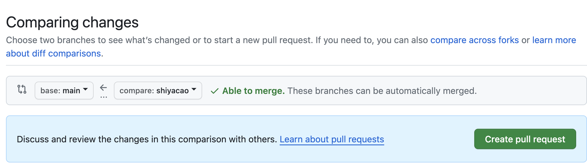 

### Merge

Once both group members have been fine with changes, we are ready to merge those changes into the main branch. Open each pull request. If everything is good and ready to merge, you will see a green checkmark that says “This branch has no conflicts with the base branch.” Click the button to “Merge Pull Request” and then click the button "Confirm merge".

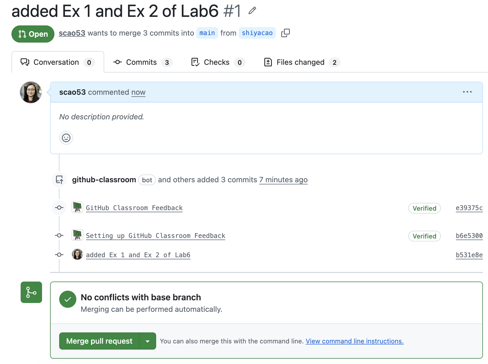

### Double Check Your Submission

Once both of you have confirmed merge, head to the Lab6.qmd file in the main branch of your group repo on GitHub.com and double check if all the changes both of you have made are shown up in the submission.

## Assessment

You will be evaluated on the completion of your lab.

In this assignment, the following standards will be assessed (the number in () indicates the maximum points you can earn for a paticulrar standard for this lab):

GITHUB (0.33)

---
## Troubleshooting Common Issues

The workflow presented above seems to work all fine and dandy, but there are a number of factors that can impede this seamless workflow. In this final section of the lab, we will go over three kinds of errors that you might come across in the workflow above, and talk about how you would resolve them. I can almost guarantee that you will deal with some of these issues when working on your group projects, so I would encourage you to keep this lab handy when engaging in project work.

### Push Error

A push error occurs when we make changes to files on our local machines, and go to commit and push them to GitHub.com, but other changes had already been made to the file at GitHub.com that were not yet pulled into our local environments. We get an error because our local repo is inconsistent with the remote repo. **To fix this error, we need to pull changes to our local machine, and try committing and pushing again**. An easy way to avoid a push error is to always click the blue downward arrow to pull remote changes before starting to edit files on your local machine.

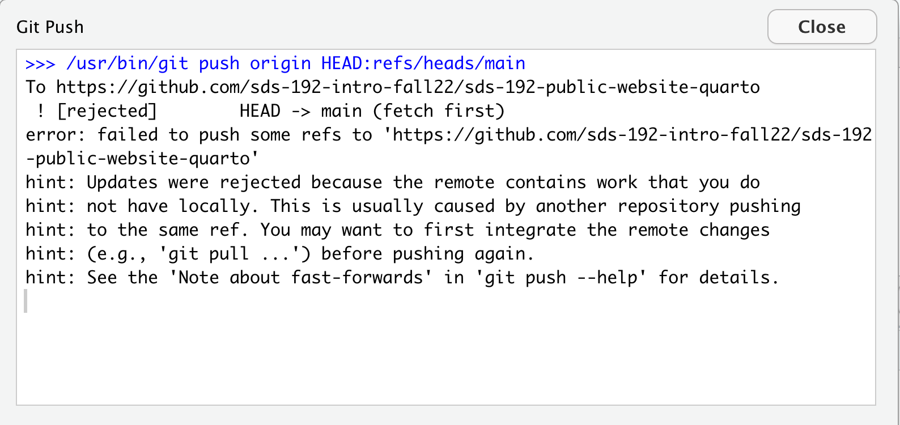

### Pull Error

A pull error occurs when changes have already been made to the same location (the same line number) in both a remote file and a local file, and then we try to pull the changes from the remote repo to our local machines. As far as Git can tell, there are two options for what this line is supposed to look like, and it can’t tell which to prioritize. So Git recommends that, as a first step, we commit the changes that we made locally. 

If this seems confusing imagine this: let’s say you write a paper, and you share it with one of your classmates to review. The classmate reads through it, makes suggested changes to the opening sentence, and sends it back you, but, while your classmate was reviewing the paper, you were getting antsy about the paper deadline and started making your own edits to the paper, including edits to the opening sentence. Now you’re trying to incorporate the changes from your classmate’s review, and you’re not sure what to do about that opening sentence. As a first step, you have two options you can scrap your recent changes (maybe your classmate’s suggestions were better!) or you can save a separate copy of the file with your recent changes and figure out later how to resolve the differences. That’s exactly what we are going to do here. **To fix this error, you should stage and commit your local changes and then try pulling again**. 

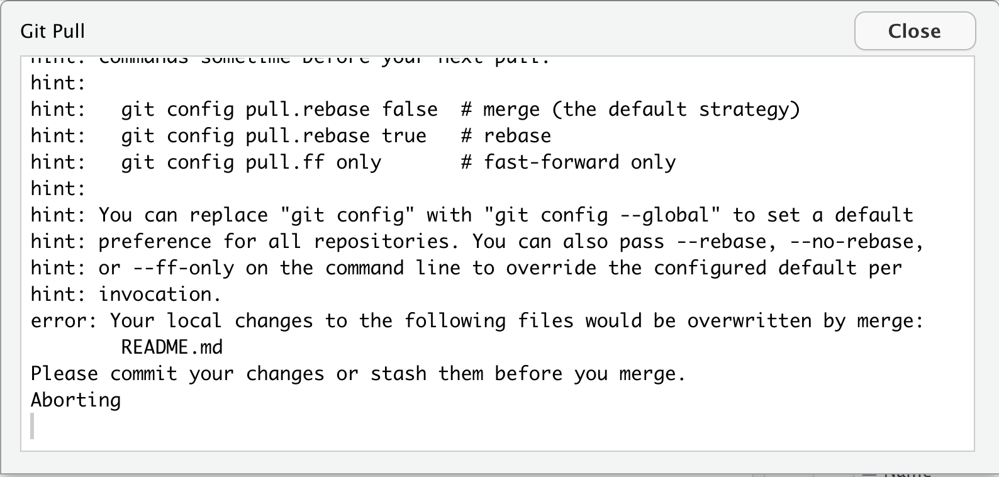

### Merge Conflict

Let’s return to the example of trying to incorporate a peer’s edits to a paper that you have recently made changes to. We have to figure out what to do about that opening sentence. Do we want our version, their version, or some combination of the two? This is what it is like to fix a merge conflict. **To fix this error, open the file with conflicts and edit the lines with conflict**.

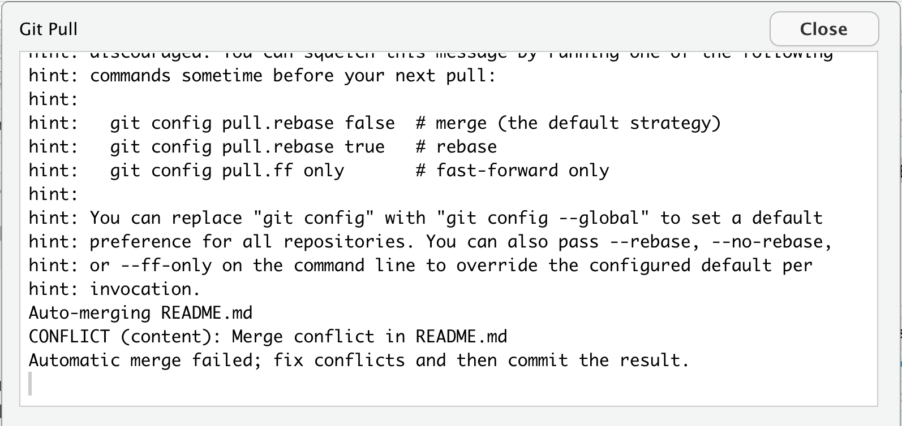

When you see the error message shown in the above screenshot, I suggest that you copy and paste `git config pull.rebase false` in your RStudio terminal and click enter. This will pull both changes maded remotely and locally in the same location (the same line number). Scroll to the section of the file with the conflict. It will now look something like this:

    <<<<<<< HEAD

    =======

    >>>>>>> ee175895783b64e0e1f696d9456be4c4c7c3f3bf

The code following HEAD represents the recent changes you made on your local machine, and the code right before the long string of characters represents the changes that were made in an earlier commit (the long string of characters is the commit hash). Decide what that line should look like and delete all other content. This means you must delete “<<<<<<< HEAD”, “=======”, and “>>>>>>> <long-hash>”, and you likely should delete at least one other line. Save the file, stage the file by clicking the checkbox next to the file under the Git tab, and then commit your changes, and push them to GitHub.com.

You may have noticed that the most frustrating merge conflicts tend to emerge when we have two people working on the same line of a repo’s file. The most effective way to avoid merge conflicts is to ensure that collaborators are working on different documents or different lines in a file. One way you might do this when starting to work on your group project is to open a file that you all plan to work on and having one of your team mates section off space of that file for different people to work. It might look something like this:

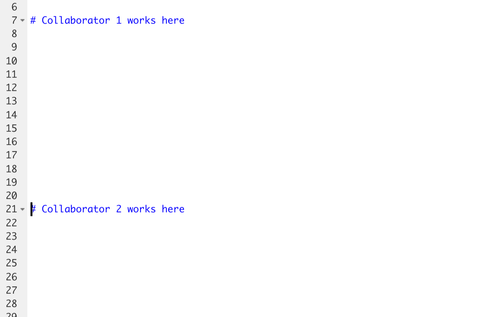

Once this change has been made, that group mate should stage, commit, and push the file to GitHub, and the other group mate should pull the change to their local machine.
